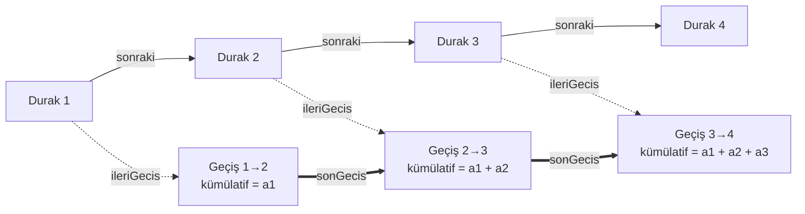

# Dogruluk

**Durakları ve duraklar arası geçişleri birbirinden ayıran, "gelmesine kalan süre"yi kümülatif olarak üreten bağlı liste tabanlı bir veri yapısı (C++).**


> **English summary** — *Dogruluk* is a small C++ data structure that models a transit line as a singly linked list of stops, while keeping all timing data on the **transitions between stops** instead of inside the nodes. Each transition is created from the previous transition's cumulative result, so appending a stop is O(1) and every stop carries a ready-to-read "minutes until arrival" value. Built as a course project for Data Structures and Algorithms at Atatürk University.

---

## Fikir

Klasik bağlı listede veri düğümün içinde durur. Oysa bir otobüsün gecikmesi durakta değil, **iki durak arasındaki yolda** oluşur. Bu yapı o yüzden iki şeyi ayırır:

- **Durak düğümü** yalnızca kimlik ve bağlantı taşır (durak numarası, sonraki durak).
- **Geçiş verisi** iki durak arasındaki hesabı taşır (anlık süre, kümülatif süre).

Yeni bir durak eklendiğinde oluşan geçiş, bir önceki geçişin kümülatif sonucunu alıp kendi süresini üstüne ekler. Böylece her durak için "gelmesine kalan dakika" baştan sona yeniden toplanmadan, ekleme anında hazır olur.

Algoritma diliyle: **kenarlarında ağırlık tutan bir yol (path) üzerinde, ekleme sırasında hesaplanan önek toplamı (prefix sum).**

## Mimari



Kalın oklar bir işaretçi değil, **veri akışıdır**: `GecisVerisi` kendinden önceki ya da sonraki geçişi göstermez. Zinciri, `Dogruluk` sınıfının tuttuğu tek bir `sonGecis` işaretçisi kurar.

### Bileşenler

| Yapı | Tuttuğu şey | Görevi |
| --- | --- | --- |
| `DurakDugumu` | `durakNO`, `sonraki`, `ileriGecis` | Durağın kimliği ve bağlantıları. Hesaplanmış hiçbir değer içermez. |
| `GecisVerisi` | `anlikSure`, `kumulatifSure`, `saat`, `binemeyen` | İki durak arasındaki geçişin süresi ve o ana kadarki toplam. |
| `Dogruluk` | `bas`, `son`, `sonGecis`, `saat`, `binemeyen` | Ekleme, hesaplama, yazdırma ve bellek temizliğini yöneten sınıf. Katsayı fonksiyonları `private`. |

## Hesap modeli

Bir geçişin anlık süresi, baz sürenin iki katsayıyla çarpılmasıyla bulunur:

```
anlikSure     = 2 dk × saatKatsayisi(saat) × kapasiteKatsayisi(binemeyen)
kumulatifSure = oncekiGecis.kumulatifSure + anlikSure
```

| Saat dilimi | Katsayı | | Durakta binemeyen yolcu | Katsayı |
| --- | --- | --- | --- | --- |
| 07 – 09 | 1.3 | | 0 | 1.0 |
| 12 – 14 | 1.2 | | 1 – 5 | 1.4 |
| 17 – 19 | 1.4 | | 6 – 10 | 1.5 |
| diğer | 1.0 | | 10'dan fazla | 1.6 |

## Karmaşıklık

| İşlem | Zaman | Neden |
| --- | --- | --- |
| `durakEkle(no)` | O(1) | `son` ve `sonGecis` tutulduğu için liste gezilmez. |
| `anlikSureHesapla()` | O(1) | Sabit sayıda karşılaştırma ve çarpma. |
| `yazdir()` | O(N) | Tüm duraklar baştan sona gezilir. |
| `temizle()` | O(N) | Her düğüm ve geçiş tek tek silinir. |

Bellek kullanımı O(N): N durak için N düğüm ve N−1 geçiş.

## Derleme ve çalıştırma

Tek dosyalık, standart kütüphane dışında bağımlılığı olmayan bir programdır.

```bash
g++ -std=c++17 -o dogruluk src/dogruluk.cpp
./dogruluk          # Windows: .\dogruluk.exe
```

Visual Studio kullanıyorsan `src/dogruluk.cpp` dosyasını boş bir C++ konsol projesine eklemen yeterli.

### Örnek çıktı

Girdi: 5 durak, saat 8, durakta bekleyen 3 yolcu → anlık süre `2 × 1.3 × 1.4 = 3.64 dk`

```text
Durak sayısı: 5
Saat (6-23): 8
Durakta bekleyen yolcu sayısı: 3

--- DURAK BAZLI GELMESİNE KALAN SÜRE ---

Durak 1 -> 2 | Gelmesine Kalan Dakika: 3.64 dk
Durak 2 -> 3 | Gelmesine Kalan Dakika: 7.28 dk
Durak 3 -> 4 | Gelmesine Kalan Dakika: 10.92 dk
Durak 4 -> 5 | Gelmesine Kalan Dakika: 14.56 dk
```

## Nerede işe yarar?

- **Toplu taşıma:** Yolcunun bekleme süresi yalnızca bir sonraki durağa olan mesafeye değil, önceki duraklarda biriken gecikmeye de bağlıdır.
- **Ağ gecikmesi:** Bir paketin toplam gecikmesi, geçtiği her bağlantıdaki gecikmelerin toplamıdır; hesap düğümde değil bağlantıda yapılır.

## Sınırlamalar ve geliştirme fikirleri

Bu bir ders projesidir; modelin şu anki sınırları şunlar:

- `saat` ve `binemeyen` tüm hat için tek değerdir, bu yüzden her geçişin anlık süresi aynı çıkar. Durak başına yolcu sayısı ve geçiş başına baz süre (mesafe) alınırsa model gerçek veriye yaklaşır.
- Saat, kümülatif süre ilerledikçe güncellenmez; uzun hatlarda saat dilimi değişimi hesaba katılabilir.
- Araya durak ekleme ve durak silme yoktur. Eklenirse sonraki geçişlerin kümülatif değerleri yeniden hesaplanmalıdır (O(N)).
- Bellek `temizle()` ile elle bırakılır. Yıkıcı (destructor) eklenip kopyalama kapatılırsa sınıf kendi belleğini güvenle yönetir.
- Girdi doğrulaması yalnızca saat için yapılır.

## Sunum

Tasarım kararlarının ve kodun adım adım anlatımı: [`docs/Dogruluk_Sunum.pdf`](docs/Dogruluk_Sunum.pdf)

## Hakkında

**Hüseyin Emir Akay** — Atatürk Üniversitesi, Bilgisayar Mühendisliği
MBM203 Veri Yapıları ve Algoritmalar dersi dönem projesi (2025–2026 Güz).

[GitHub](https://github.com/EmirAkay-007) · [LinkedIn](https://www.linkedin.com/in/huseyinemirakay)

## Lisans

Kaynak kod [MIT Lisansı](LICENSE) ile yayımlanmıştır: telif bildirimi korunduğu sürece dilediğiniz gibi kullanabilir, değiştirebilir ve dağıtabilirsiniz. `docs/` altındaki sunum bilgilendirme amaçlıdır; içindeki kurum logoları ilgili kurumlara aittir.
