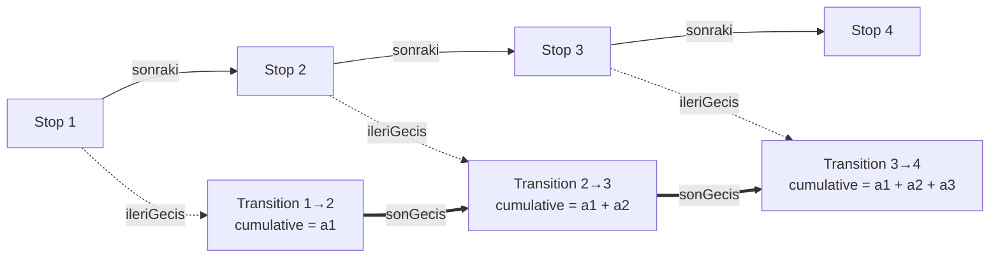

# Dogruluk

**English** | [Türkçe](README.tr.md)

**A linked-list-based data structure that keeps stops and the transitions between them apart, and produces "minutes until arrival" cumulatively (C++).**


Built as a term project for Data Structures and Algorithms at Atatürk University. The name is Turkish for "accuracy"; identifiers in the code are in Turkish and are explained below.

---

## The idea

In a classic linked list the data lives inside the node. But a bus is not delayed at a stop; it is delayed **on the road between two stops**. This structure therefore separates two things:

- A **stop node** carries only identity and links (stop number, next stop).
- A **transition record** carries the calculation between two stops (its own duration and the cumulative duration).

When a stop is appended, the new transition takes the cumulative result of the previous transition and adds its own duration. Every stop therefore has its "minutes until arrival" ready at insertion time, without summing the line again from the start.

In algorithmic terms: **a prefix sum over a path whose weights live on the edges, computed during insertion.**

## Architecture



The thick arrows are **data flow**, not pointers: a transition record does not point to the one before or after it. The chain is built through a single `sonGecis` ("last transition") pointer held by the `Dogruluk` class.

### Components

| Type | Holds | Role |
| --- | --- | --- |
| `DurakDugumu` (stop node) | `durakNO`, `sonraki` (next), `ileriGecis` (forward transition) | Identity and links of a stop. Contains no computed value. |
| `GecisVerisi` (transition record) | `anlikSure` (own duration), `kumulatifSure` (cumulative duration), `saat` (hour), `binemeyen` (passengers left waiting) | Duration of one transition and the running total up to it. |
| `Dogruluk` | `bas` (head), `son` (tail), `sonGecis`, `saat`, `binemeyen` | Appending, calculation, printing and memory clean-up. The coefficient functions are `private`. |

## Calculation model

The duration of one transition is a base time multiplied by two coefficients:

```
anlikSure     = 2 min × saatKatsayisi(saat) × kapasiteKatsayisi(binemeyen)
kumulatifSure = previousTransition.kumulatifSure + anlikSure
```

| Hour of day | Coefficient | | Passengers left waiting | Coefficient |
| --- | --- | --- | --- | --- |
| 07 – 09 | 1.3 | | 0 | 1.0 |
| 12 – 14 | 1.2 | | 1 – 5 | 1.4 |
| 17 – 19 | 1.4 | | 6 – 10 | 1.5 |
| other | 1.0 | | more than 10 | 1.6 |

## Complexity

| Operation | Time | Why |
| --- | --- | --- |
| `durakEkle(no)` (append a stop) | O(1) | `son` and `sonGecis` are kept, so the list is never traversed. |
| `anlikSureHesapla()` | O(1) | A fixed number of comparisons and multiplications. |
| `yazdir()` (print) | O(N) | Walks every stop from head to tail. |
| `temizle()` (clean up) | O(N) | Deletes every node and transition one by one. |

Memory use is O(N): N nodes and N−1 transitions for N stops.

## Build and run

A single-file program with no dependencies beyond the standard library.

```bash
g++ -std=c++17 -o dogruluk src/dogruluk.cpp
./dogruluk          # Windows: .\dogruluk.exe
```

In Visual Studio, add `src/dogruluk.cpp` to an empty C++ console project.

### Sample output

Input: 5 stops, hour 8, 3 passengers waiting → duration per transition `2 × 1.3 × 1.4 = 3.64 min`

The program's prompts and output are in Turkish:

```text
Durak sayısı: 5
Saat (6-23): 8
Durakta bekleyen yolcu sayısı: 3

--- DURAK BAZLI GELMESİNE KALAN SÜRE ---

Durak 1 -> 2 | Gelmesine Kalan Dakika: 3.64 dk
Durak 2 -> 3 | Gelmesine Kalan Dakika: 7.28 dk
Durak 3 -> 4 | Gelmesine Kalan Dakika: 10.92 dk
Durak 4 -> 5 | Gelmesine Kalan Dakika: 14.56 dk
```

Each line reads "Stop A -> B | minutes until arrival".

## Where it is useful

- **Public transport:** a passenger's waiting time depends not only on the distance to the next stop but also on the delay accumulated at earlier stops.
- **Network latency:** the total delay of a packet is the sum of the delays on every link it crosses; the calculation belongs to the link, not the node.

## Limitations and ideas for improvement

This is a course project. The current limits of the model:

- `saat` and `binemeyen` are single values for the whole line, so every transition gets the same duration. Taking a passenger count per stop and a base time (distance) per transition would bring the model closer to real data.
- The hour is not advanced as the cumulative time grows; on long lines a change of time band could be taken into account.
- Stops cannot be inserted in the middle or removed. If added, the cumulative values of the later transitions would have to be recalculated (O(N)).
- Memory is released by hand with `temizle()`. Adding a destructor and disabling copying would let the class manage its own memory safely.
- Input is validated only for the hour.

## Presentation

A step-by-step walk through the design decisions and the code (in Turkish): [`docs/Dogruluk_Sunum.pdf`](docs/Dogruluk_Sunum.pdf)

## About

**Hüseyin Emir Akay**, Computer Engineering, Atatürk University
Term project for MBM203 Data Structures and Algorithms (Fall 2025–2026).

[GitHub](https://github.com/EmirAkay-007) · [LinkedIn](https://www.linkedin.com/in/huseyinemirakay)

## License

The source code is released under the [MIT License](LICENSE): free to use, modify and distribute as long as the copyright notice is kept. The presentation under `docs/` is for information only; the institutional logos in it belong to their owners.
